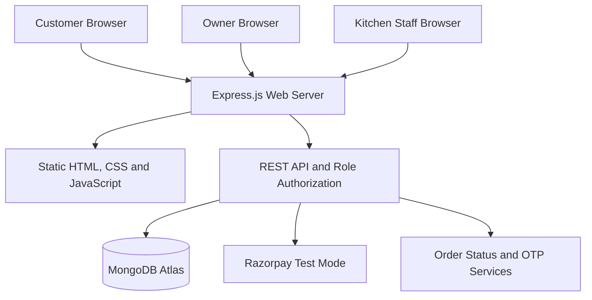

<p align="center">
  
</p>

# ☕ Brew & Bite Café Management System

**A full-stack, role-based café ordering and management application** built as a final-year college project using HTML, CSS, JavaScript, Node.js, Express and MongoDB.

Customers can browse the café menu, place orders and track preparation. The café owner can manage daily operations, products, staff and loyalty offers. Approved kitchen staff can process orders and verify collection OTPs.

> **Deployment:** The academic demonstration website is hosted on Render Free, with MongoDB Atlas for persistent data. Online payments use **Razorpay Test Mode**; no real money is collected. Public availability does not mean every deployed workflow has been fully verified.

## 🌐 Live Application — Choose Your Portal

| User role | Live website | Access and purpose |
| --- | --- | --- |
| **☕ Customer** | **[Open Customer Website](https://brew-and-bite-cafe-15.onrender.com/)** | Browse menu and offers; register or sign in to add items to cart, checkout, track orders and access receipts. |
| **👑 Café Owner / Admin** | **[Open Owner Dashboard](https://brew-and-bite-cafe-15.onrender.com/owner.html)** | Owner sign-in required. Manage menu, product photos, tables, staff approvals, orders, customers, targeted offers and reports. |
| **👨‍🍳 Kitchen Staff** | **[Open Kitchen Dashboard](https://brew-and-bite-cafe-15.onrender.com/kitchen.html)** | Approved staff account required. View accepted orders, update preparation status and verify handover OTPs. |

**Other live links:** [Sign in](https://brew-and-bite-cafe-15.onrender.com/login.html) · [Customer registration](https://brew-and-bite-cafe-15.onrender.com/register.html) · [Request kitchen staff access](https://brew-and-bite-cafe-15.onrender.com/staff-register.html) · [Menu](https://brew-and-bite-cafe-15.onrender.com/menu.html) · [Offers](https://brew-and-bite-cafe-15.onrender.com/offers.html) · [About](https://brew-and-bite-cafe-15.onrender.com/about.html)

**How access works:**

- **Customers:** Create a customer account using the registration page, or sign in with an existing customer account. Customer accounts cannot access owner or kitchen management APIs.
- **Owners:** The first owner account is created securely with the `npm run owner:create` initialization command. No public owner registration or demo administrator credentials are provided.
- **Kitchen staff:** Request an account through the staff registration page. The owner must approve the request before the staff member can sign in to the kitchen workspace.

Owner and Kitchen URLs are *entry points*, not publicly accessible management data: protected actions require authentication and the correct role. **Render Free may take a short time to wake after inactivity**, so the first visit can be slower.

**Source code:** [github.com/gauriadmane07-cloud/brew-and-bite-cafe](https://github.com/gauriadmane07-cloud/brew-and-bite-cafe)

---

## Project Overview

Brew & Bite replaces disconnected, manual café workflows with a single web application. It connects customer orders to the owner's order queue and the kitchen board, while storing users, menu items, payments, table assignments, customer offers and receipts in MongoDB.

### Main Features

| Module | Key capabilities |
| --- | --- |
| **Customer accounts** | Registration, login/logout, role-aware navigation and profile updates |
| **Digital menu & cart** | Database-backed categories, search, item availability, quantity adjustment and cart totals |
| **Checkout & ordering** | Table selection, instructions, configurable tax, eligible coupons and server-side order pricing |
| **Payment management** | Cash collection tracking and Razorpay **test** payments for UPI/card; retry of eligible interrupted payments |
| **Order tracking** | `Placed → Accepted → Preparing → Ready → Completed`, plus permitted cancellation |
| **Kitchen management** | Accepted-order queue, item instructions, status updates and secured six-digit OTP handover |
| **Owner administration** | Menu/category CRUD, product photo uploads, tables, staff approvals, cash confirmation and order management |
| **Customer loyalty** | Customer directory, order history and selected-customer or regular-customer discount offers |
| **Reporting** | Confirmed-sales summaries, date filters, CSV exports and printable receipts |
| **Security** | Password hashing, JWT authentication cookies, role restrictions, validation, CSRF controls and payment signature verification |

### Customer Loyalty Rule

A customer qualifies as a **regular customer** after **five or more completed orders with confirmed payment in the rolling last seven days**. The owner can create a discount for a single customer, multiple selected customers, all qualifying regulars or the public. The backend verifies eligibility and recalculates discounts during checkout. Cancelled or unpaid orders do not count toward loyalty qualification.

### Payment and OTP Policy

- Cash orders remain **Payment Pending** until the owner confirms collection.
- Online transactions use **Razorpay Test Mode** only and must pass backend payment verification before being treated as confirmed.
- Online payments that are not completed can be retried from the existing eligible order rather than creating a duplicate.
- When an eligible order is ready, a short-lived OTP is used for handover. Payment must be confirmed before completion.
- The built-in customer OTP view supports an academic demonstration without requiring a paid SMS service.

---

## Technology Stack

| Layer | Technology |
| --- | --- |
| Frontend | HTML5, CSS3, vanilla JavaScript, Fetch API |
| Backend and API | Node.js 22, Express.js 4, REST APIs |
| Database | MongoDB Atlas, Mongoose 8 |
| Authentication | JWT, bcryptjs, secure HttpOnly cookies, role-based authorization |
| Validation / security | Zod, Helmet, express-rate-limit, CSRF protection |
| Payments | Razorpay Node SDK in **Test Mode** |
| Notifications | In-app collection OTP; optional Nodemailer integration |
| Testing | Node.js built-in test runner; regression and validation tests |
| Hosting | Render Free (one Node web service), MongoDB Atlas Free |
| Version control | Git and GitHub |

## Application Architecture



The same Express application serves the frontend and `/api` endpoints. The frontend uses Fetch API to communicate with the backend. Database writes, authorization and payment confirmation are handled by the server, not trusted to client-side JavaScript.

### Development Approach

1. **Requirements analysis:** Defined Customer, Owner and Kitchen Staff permissions and the order lifecycle.
2. **Database modeling:** Designed Mongoose schemas for users, products, categories, tables, offers, orders, payments and OTPs.
3. **Backend APIs:** Implemented modular authentication, catalog, ordering, owner, kitchen, payment and reporting routes.
4. **Frontend development:** Created responsive, role-aware HTML pages with shared CSS and JavaScript helpers.
5. **Business logic:** Added server-side price calculations, table occupancy control, offers and loyalty eligibility.
6. **Payment and handover:** Integrated Razorpay Test Mode, cash confirmation and OTP-based completion.
7. **Testing and deployment:** Added automated checks, local role-based workflow tests and Render configuration.

---

## Run Locally

### Requirements

- Node.js 20 or newer (Node.js 22 is used for cloud deployment)
- npm, Git and VS Code or another code editor
- A MongoDB Atlas database and a database user with access to `brew_and_bite`
- Optional Razorpay **Test Mode** keys for online checkout

### Installation (Windows Command Prompt)

```bat
git clone https://github.com/gauriadmane07-cloud/brew-and-bite-cafe.git
cd brew-and-bite-cafe
npm ci
copy .env.example .env
notepad .env
```

Set `MONGODB_URI` and `JWT_SECRET` in the local `.env` file. Use only Razorpay test credentials if enabling online payment; do not put real secrets in source code.

To generate a strong JWT secret:

```bat
node -e "console.log(require('node:crypto').randomBytes(48).toString('hex'))"
```

Run the verification scripts and start the server:

```bat
npm run check
npm test
npm run dev
```

Open **http://localhost:3000/**.

### First-Time Database Initialization Only

If this is a **new, empty database**:

```bat
npm run seed
set "OWNER_EMAIL=owner@example.com"
set "OWNER_PASSWORD=REPLACE_WITH_YOUR_OWN_UNIQUE_12_PLUS_CHARACTER_PASSWORD"
set "OWNER_NAME=Brew and Bite Owner"
npm run owner:create
set "OWNER_EMAIL="
set "OWNER_PASSWORD="
set "OWNER_NAME="
```

Use your own email and password; these are placeholders. **Do not rerun initialization for a database that already contains your owner account and café records.**

## Environment Configuration

Copy [`.env.example`](.env.example) and supply private values locally or in Render Environment settings.

| Variable | Purpose |
| --- | --- |
| `NODE_ENV` | `development` locally, `production` on Render |
| `PORT` | Local server port (Render sets its own port) |
| `MONGODB_URI` | Private MongoDB Atlas connection string |
| `JWT_SECRET` | Secret used to sign authentication tokens |
| `TAX_BPS` | Configured tax rate in basis points; `0` disables tax |
| `RAZORPAY_KEY_ID` | Razorpay Test Mode key ID |
| `RAZORPAY_KEY_SECRET` | Razorpay Test Mode secret |
| `RAZORPAY_WEBHOOK_SECRET` | Secret used to verify signed webhook events |
| `SMTP_*` | Optional email settings; not required for in-app OTP |

**Never commit `.env`, passwords, payment secrets, JWT secrets or customer exports.**

## Project Structure

```text
brew-and-bite-cafe/
├── public/                Responsive HTML, CSS, JS and SVG assets
│   ├── index.html         Customer homepage
│   ├── owner.html         Owner dashboard
│   ├── kitchen.html       Kitchen workspace
│   └── js/                Shared UI, checkout and role-specific code
├── src/
│   ├── app.js             Express application and route setup
│   ├── config/            Environment and MongoDB connection
│   ├── models/            Database schemas
│   ├── routes/            REST API modules
│   ├── middleware/        Authentication, CSRF and error handling
│   ├── services/          Billing, loyalty, OTP and payments
│   └── jobs/              Eligible unpaid-order expiry checks
├── scripts/               Setup, seed and source checks
├── tests/                 Automated regression tests
├── docs/                  API, database, testing and deployment guides
├── .env.example           Safe environment template
├── package.json
├── package-lock.json
├── render.yaml            Render Free deployment blueprint
└── server.js              Application entry point
```

## Testing

```bat
npm run check
npm test
npm audit --omit=dev
```

Manual testing should cover customer registration/login, product filtering, cart and checkout, selected-customer discount restrictions, cash and Razorpay test payments, owner order acceptance, approved staff access, OTP handover, receipts, reports and unauthorized access checks. Record actual results separately from expected results.

See the [Testing Guide](docs/TESTING_GUIDE.md).

## Cloud Deployment

**Public application:** [https://brew-and-bite-cafe-15.onrender.com/](https://brew-and-bite-cafe-15.onrender.com/)

The repository is configured for **one Render Free Node.js Web Service**, with the static frontend and Express API deployed together. MongoDB Atlas provides persistence, including owner-uploaded product images.

| Render setting | Value |
| --- | --- |
| Repository | `gauriadmane07-cloud/brew-and-bite-cafe` |
| Branch | `main` |
| Build command | `npm ci --omit=dev` |
| Start command | `npm start` |
| Health check | `/api/health` |
| Environment | Node.js 22, `NODE_ENV=production` |

To deploy or redeploy, connect the repository to Render, add the private environment variables, and allowlist the Render outbound CIDR ranges in MongoDB Atlas. Configure the Razorpay Test Mode webhook at:

```text
https://brew-and-bite-cafe-15.onrender.com/api/payments/webhook
```

The webhook secret in Render must match the one configured in the Razorpay Test Dashboard. Do not enable real payment collection for this academic demonstration.

Full instructions: [Deployment Guide](docs/DEPLOYMENT_GUIDE.md).

### Free-Tier and Demonstration Limitations

- Render Free may sleep after inactivity and delay the first incoming request.
- MongoDB Atlas Free has storage, usage and inactivity limits.
- Local server files are not reliable for permanent uploads; product photos are kept in MongoDB.
- Unpaid online orders are eligible for expiry after 30 minutes, but checks only execute when the server runs (and on startup), not while a free instance is asleep.
- In-app OTP works without SMS. External email/SMS delivery is not guaranteed on the free deployment.
- **Razorpay is configured for test transactions, not real payments.** Refund handling and production-grade payment operations are not part of this academic release.
- Hosted registration, payment callbacks, role permissions and reporting should be manually retested after each significant deployment.

## Documentation

- [API Documentation](docs/API_DOCUMENTATION.md)
- [Database Design](docs/DATABASE_DESIGN.md)
- [Testing Guide](docs/TESTING_GUIDE.md)
- [Render Deployment Guide](docs/DEPLOYMENT_GUIDE.md)

## Project Scope and Security Notice

This repository is for **academic learning and demonstration**. It illustrates full-stack development, authentication, backend validation, persistent storage, payment testing, role-based dashboards and cloud deployment. It is **not presented as a production-ready payment or customer-data system** without additional security, operational and compliance review.

---

<p align="center"><strong>Brew & Bite Café — From order placement to kitchen handover, in one application.</strong></p>
