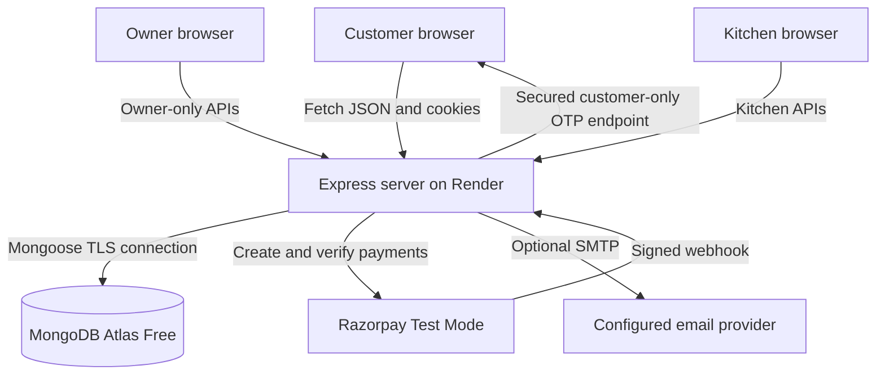
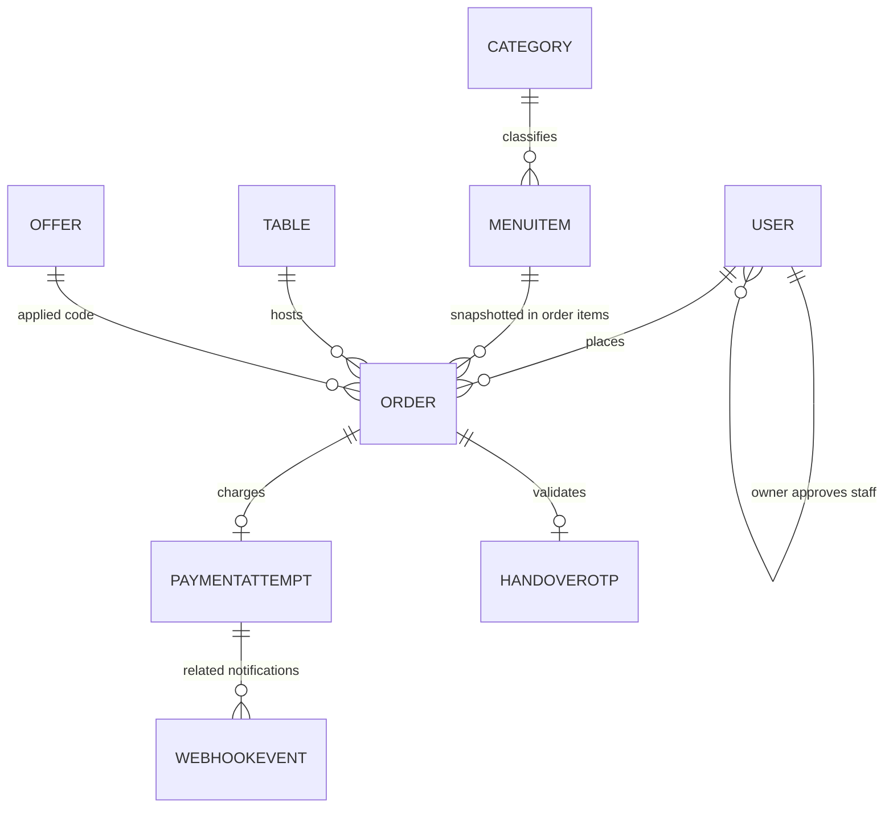
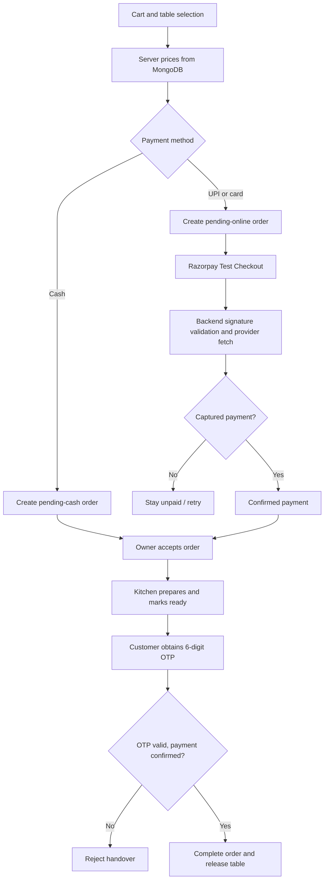

# Architecture and MongoDB design

## Application architecture

One Express service serves static files from `/public` plus JSON REST APIs under `/api`. Browsers keep the cart in localStorage, but all actual order totals come from MongoDB. The frontend uses the same origin for all API calls and JWT is stored in an HTTP-only cookie.

## Collections and attributes

### `users`

- `_id` ObjectId (PK), `name`, `email` unique/indexed and lowercase, `passwordHash` excluded from standard queries, `role` enum `customer|owner|staff`, `approval` enum `pending|approved|rejected`, `active`, `phone`, `createdAt`, `updatedAt`.
- Staff requests are `users` with role `staff` and approval `pending`; separate staff collection isn't necessary. Owner creation is via `npm run owner:create` only.

### `categories`

- `_id`, `name`, `slug` unique, `active`, timestamps.
- Referenced by MenuItem `category`.

### `menuitems`

- `_id`, `name`, `description`, `category` FK, `pricePaise` integer, `imageKey` local illustration name, `available`, `active`, timestamps.
- Items are deactivated, not deleted; order snapshots stay unchanged.

### `tables`

- `_id`, `number` unique, `active`, `occupiedBy` optional Order FK, timestamps.
- Check-and-reserve with atomic `findOneAndUpdate({occupiedBy:null})` to prevent concurrent table selection. Table is released on completion/cancellation/expiry.

### `offers`

- `_id`, `code` unique uppercase, `type` percent/fixed/combo, `value`, `minimumPaise`, `comboItems` (menuItem FK + quantity), `comboPricePaise`, `expiresAt`, `active`, timestamps.
- Discounts are recalculated against current cart snapshots on checkout. Combo discount uses the required bundle counts and current prices.

### `orders`

- `_id`, unique `orderNumber`, `customer` FK, `table` FK, `tableNumber` snapshot, `items[]` with menuItem FK/name/unitPricePaise/quantity/lineTotalPaise, `instructions`, `offerCode`.
- `subtotalPaise`, `discountPaise`, `taxPaise`, `taxBps`, `totalPaise`.
- `paymentMethod`: cash/upi/card; `paymentStatus`: Pending/Confirmed/Failed/Expired; `orderStatus`: Placed/Accepted/Preparing/Ready/Completed/Cancelled.
- `providerOrderId`, `providerPaymentId`, `paidAt`, `readyAt`, `completedAt`, `cancelledAt`, `expiresAt`, `requiresReview`, timestamps.
- Indexed by customer, statuses and creation date.

### `paymentattempts`

- `_id`, unique Order FK, unique `providerOrderId`, `providerPaymentId`, status, failureReason, timestamps.
- The provider is checked before confirming money receipt; duplicate callbacks are idempotent.

### `handoverotps`

- `_id`, unique Order FK, `hash` (bcrypt), `expiresAt`, `issuedAt`, `lastCustomerRequestedAt`, `attempts`, `usedAt`, timestamps.
- The OTP plaintext is sent optionally to a configured email and may be shown **only to the authenticated order owner** by explicitly requesting a new OTP. No unhashed OTP is stored.

### `webhookevents`

- `_id`, unique Razorpay event ID (or deterministic content hash fallback), event type, timestamps.
- Deduplicates webhook deliveries. During processing failures, the event is removed so the provider can retry.

## Relationship diagram

(The USER self-relationship symbolizes an authorization operation rather than a stored FK. `webhookevents` stores an event key, not a direct PaymentAttempt FK.)

## Order workflow

```mermaid
stateDiagram-v2
  [*] --> Placed: customer places order
  Placed --> Accepted: owner accepts; online paid first
  Placed --> Cancelled: eligible unpaid cancellation
  Accepted --> Preparing: approved kitchen staff
  Accepted --> Cancelled: owner cancels unpaid order
  Preparing --> Ready: approved kitchen staff
  Ready --> Completed: valid OTP AND confirmed payment
  Cancelled --> [*]
  Completed --> [*]
```

## Key design choices and limitations

- Integer paise avoid currency floating-point rounding errors.
- Auth guards run on every request; each protected route checks roles on the server.
- Orders retain name/price snapshots after menu edits.
- Expiry protects paid orders from timed cancellation but cannot promise execution on a sleeping free instance.
- Atlas multi-document transactions are not used. Reservation and order creation are best-effort compensated on ordinary errors, but a crash between table reservation and order insertion could leave a table occupied. An administrator repair/reconciliation feature would be desirable for live deployment.
- A completed payment that arrives after expiry is flagged for owner review, not automatically refunded.
- No inventory deduction because inventory management is out of project scope.
- Dates in reports use `Asia/Kolkata` for grouping; order creation timestamps are stored as UTC by MongoDB.

### Version 1.2: product photos

- `MenuItem.imageVersion` — number; 0 or missing means built-in illustration. Incremented on upload/replacement; reset on removal.
- `MenuPhoto` — `{menuItem: ObjectId (unique), bytes: Buffer, contentType: 'image/jpeg', createdAt, updatedAt}`. Limited to one compact image per menu item.
- `Order.gatewayMethod` — optional actual Razorpay captured payment channel; older records lack it and use `paymentMethod`.
- No manual migration or reseeding required for pre-existing orders/menu items.

## Version 1.3 fields and indexes

`offers.audience` is an enum (`all`, `selected`, `regular`), default `all`. `offers.eligibleCustomers` is an array of User ObjectId references; the server validates that each is an active customer. Old offers without this field are treated as `all` without a migration. Customer segmentation is computed from `orders`, not from a saved VIP checkbox. `orders` has a compound index `(customer, completedAt, orderStatus, paymentStatus)` for the rolling 7-day completed-and-paid query.

Owner customer directory never returns `passwordHash`. Only owner APIs return customer contact information. Customer-specific codes are visible only through authenticated `/api/offers/mine` and cannot be redeemed by other accounts.
